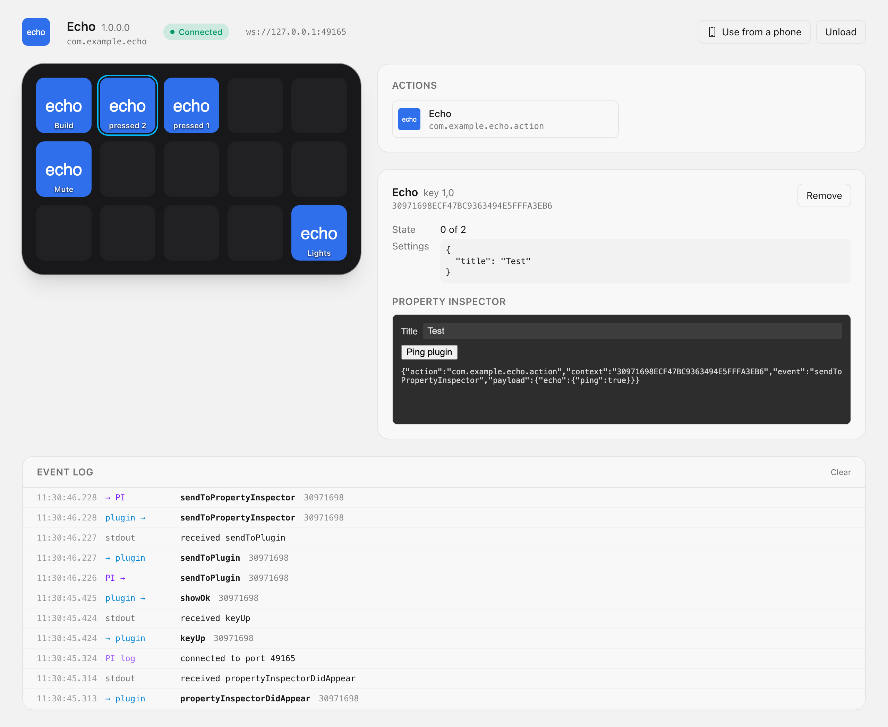
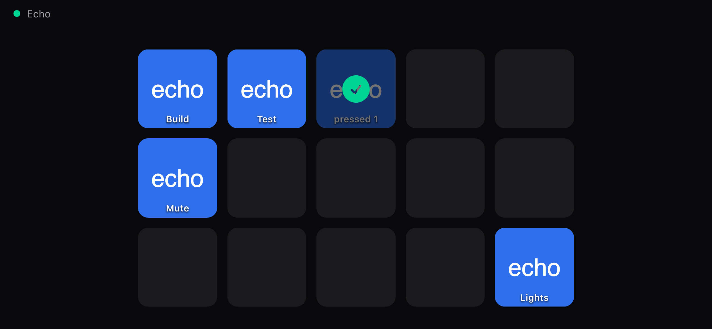

# Stream Deck emulator

A local emulator of the Elgato Stream Deck app for testing Stream Deck SDK v2
plugins without hardware. It:

- launches a plugin the way the Stream Deck app does and speaks its WebSocket
  protocol, relaunching the plugin if it crashes;
- shows a virtual 5×3 device in the browser: press keys and see the titles,
  images and OK/alert feedback the plugin sends back;
- hosts the plugin's Property Inspector (PI) and connects it, so settings edited
  in the PI reach the plugin;
- lets phones on the local network use the deck, paired with a QR code;
- has a JSON control API and a CLI for scripts and CI;
- builds as a desktop app for macOS, Windows and Ubuntu/Debian.



Status: early development. [docs/protocol.md](docs/protocol.md) lists the
Stream Deck app behaviour the emulator reproduces. Profiles, multi-actions, encoders (Stream Deck +)
and the Marketplace are out of scope for now.

## Running it

The toolchain is pinned in `mise.toml` (Erlang/OTP 27, Elixir 1.20, Node 24;
Rust and Zig for the desktop app).

```sh
mise install
mix setup
mix streamdeck.run path/to/com.example.plugin.sdPlugin --open
```

The argument can be an unpacked `.sdPlugin` folder or a `.streamDeckPlugin`
package. Without it, load a plugin from the UI.

| Option | Default | |
|---|---|---|
| `--http-port PORT` | 4000 | UI and control API; 0 picks a free port |
| `--ws-port PORT` | 0 (free port) | Plugin and PI WebSocket connections |
| `--layout FILE` | | Keys to place once the plugin loads (below) |
| `--open` | | Open the UI in the browser |
| `--remote` | | Let phones use the deck right away (see below) |

When everything is up, it prints a line that scripts can wait for:

```
streamdeck-emulator ready {"url":"http://127.0.0.1:4000","ws_port":53211,"plugin":"/path/to/x.sdPlugin"}
```

During development, `mix phx.server` also works, with the plugin in
`STREAMDECK_PLUGIN` and an optional `STREAMDECK_WS_PORT`.

Everything listens on loopback only. Plugins connect to `127.0.0.1` and PIs to
`localhost`, so the WebSocket port listens on both `127.0.0.1` and `::1`.

### Layout file

```json
{
  "keys": [
    { "column": 0, "row": 0, "action": "com.example.plugin.action", "settings": { "a": 1 } }
  ]
}
```

## Using the deck from a phone

Click **Use from a phone** in the UI (or start with `--remote`) and scan the
QR code with a phone on the same network. The phone opens the keys full
screen; add the page to its home screen to keep it at hand.

<p align="center">
  
</p>

Phone access is off until you turn it on. Turning it on starts a second
listener on every network interface and makes a new pairing code; the QR code's
URL carries it, and the phone keeps it in its session. A paired phone can only
see and press keys: not the Property Inspector, the event log, the plugin
controls or the API. Turning phone access off, or on again, unpairs every
phone. Anyone who scans the code can press keys, and pressing a key runs the
plugin's action, so only share it with people you trust.

If the phone cannot load the page, the computer's firewall is probably blocking
incoming connections for the emulator (on macOS, allow them when it asks, or in
System Settings → Network → Firewall).

## Desktop app

The emulator also builds as a macOS app with [ex_tauri](https://github.com/filipecabaco/ex_tauri):
a [Tauri](https://tauri.app) window around the same Phoenix backend, which
[Burrito](https://github.com/burrito-elixir/burrito) wraps into one executable.
In the app you load a plugin with a native dialog or by dropping a `.sdPlugin`
folder or `.streamDeckPlugin` file onto the window.

`mise.toml` also pins what the app needs: Rust, and exactly Zig 0.16.0 for
Burrito.

```sh
mix ex_tauri.dev                    # the app in a native window, with live reload
MIX_ENV=prod mix desktop.build      # this machine's target
MIX_ENV=prod mix desktop.build --target universal-apple-darwin
```

`mix desktop.build` builds the backend with Burrito, names it the way Tauri's
`externalBin` expects, and runs `tauri build`. Targets:
`universal-apple-darwin` (or either Mac architecture), `x86_64-unknown-linux-gnu`
(.deb, AppImage) and `x86_64-pc-windows-msvc` (.msi, NSIS). Burrito builds any
target's backend from macOS or Linux (Windows needs `7z`), but Tauri builds each
shell only on its own OS, so the
[Desktop app workflow](.github/workflows/desktop.yml) builds every backend on
Linux (`--sidecar-only`), then bundles on macOS, Linux and Windows runners. Each
runner first runs `e2e/smoke-sidecar.mjs` against its backend: it starts it,
loads the echo fixture as a Node.js plugin and presses a key. A `v*` tag
makes a draft release with the bundles, described by that version's section of
[CHANGELOG.md](CHANGELOG.md); the tag must match the version in `mix.exs`,
`src-tauri/tauri.conf.json` and `src-tauri/Cargo.toml`.

JavaScript plugins (a `.js`, `.mjs` or `.cjs` `CodePath`, the SDK v2 default)
run with `node` from `PATH`, or `STREAMDECK_NODE`. On Linux, where the Stream
Deck app does not exist, those are the only plugins that can run.

Inside the app, the HTTP server only answers the app's own window: the shell
hands the backend a random token at launch (`ExTauri.Token`), and every request
needs it, the control API included (as `Authorization: Bearer <token>`). The CLI,
`mix phx.server` and tests run without a token. The plugin's WebSocket port is
not affected.

Burrito unpacks the backend into `~/Library/Application Support/.burrito/`
once per version. When testing a rebuild with the same version, delete
`streamdeck_emulator_desktop_*` there first, or the app keeps running the old
build.

The app icon's source is `desktop/app-icon.svg`. Render it to a PNG with a
transparent background with `node desktop/render-icon.mjs` (it uses the e2e
tests' Chromium), then regenerate the icons with
`mix ex_tauri.icon desktop/app-icon.png`.

## Control API

All bodies are JSON. Requests that change state must send
`content-type: application/json`; others get `415`, so web pages open in your
browser cannot drive the emulator. Endpoints that need a plugin return `409`
when none is loaded, and invalid input gets `422` with `{"error": ...}`.

| Method and path | Body | Does |
|---|---|---|
| `GET /api/state` | | Plugin status, WebSocket port and keys (`plugin` is `null` with nothing loaded) |
| `GET /api/events?after=ID` | | Log entries after `ID`: messages both ways, plugin output, PI console |
| `POST /api/plugin` | `{"path": "...", "layout": {...}}` | Loads a plugin, replacing the current one; `layout` is optional |
| `DELETE /api/plugin` | | Stops the plugin |
| `PUT /api/keys/:column/:row` | `{"action": "...", "settings": {...}}` | Places an action (`willAppear`) |
| `DELETE /api/keys/:column/:row` | | Removes it (`willDisappear`) |
| `POST /api/keys/:column/:row/press` | `{"hold_ms": 0}` | `keyDown`, then `keyUp` |
| `POST /api/keys/:column/:row/down` and `/up` | `{}` | One of the two |

Each key in `/api/state` has `column`, `row`, `action`, `context`, `settings`,
`state`, `title`, `image` and `feedback` (`"ok"`, `"alert"` or `null`).

## How the Property Inspector is hosted

Selecting a key loads its PI from the plugin folder, served under `/plugin/` on
the emulator's own origin, in an iframe. Once the page loads, the emulator calls
`connectElgatoStreamDeckSocket(port, uuid, "registerPropertyInspector",
applicationInfo, actionInfo)` in it, using the key's context as the PI UUID. The
PI's console output shows up in the event log.

Because the PI shares the emulator's origin, its scripts can reach the
emulator's page. That is fine for your own plugin; don't load plugins you don't
trust.

## Tests

```sh
mix test                   # unit and integration tests, with an echo fixture plugin

cd e2e
npm ci
npx playwright install chromium
npx playwright test        # browser tests; starts the emulator on port 4100
```

`test/fixtures/echo.sdPlugin` is a small Node plugin and PI that echo what they
receive, so the tests need neither Xcode nor a real plugin. To also run the
browser tests against [streamdeck-osascript](https://github.com/gabrielperales/streamdeck-osascript)
(macOS only), point `OSASCRIPT_PLUGIN` at a build of it:

```sh
OSASCRIPT_PLUGIN=/path/to/com.gabrielperales.osascript.streamDeckPlugin npx playwright test
```

## Changes

See [CHANGELOG.md](CHANGELOG.md).

## Licence

MIT
